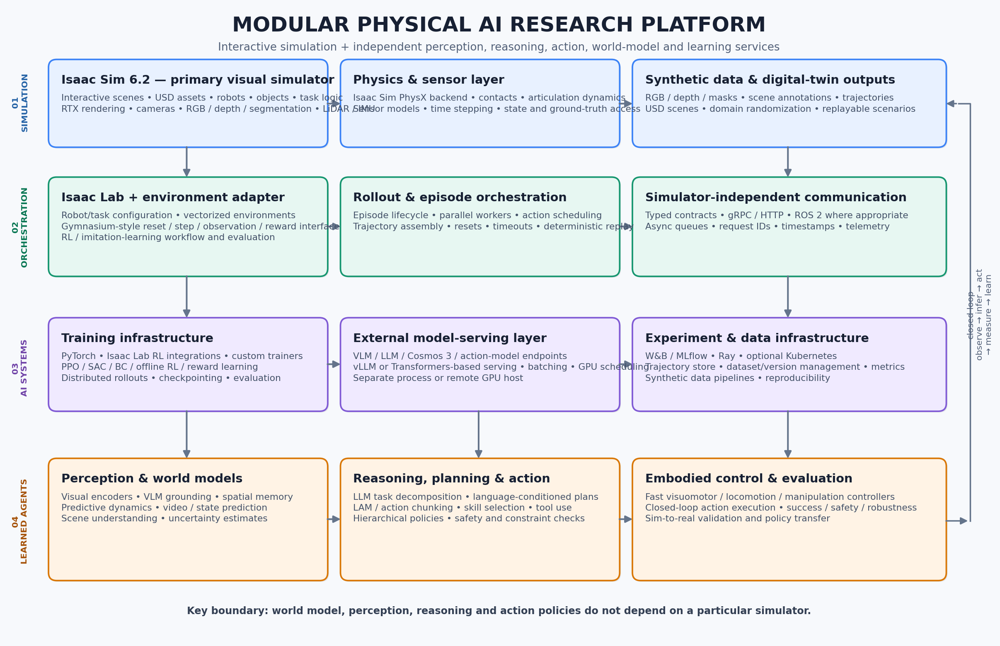

# Cohomology a Physical AI Research Platform

Advancing Physical AI through world models, simulation, and learning. A modular research platform for **embodied, multimodal intelligence**. Simulation is not merely a source of synthetic data: it is an interactive environment in which agents learn to **perceive, reason, predict, plan, and act** in dynamic worlds.

The initial platform uses **NVIDIA Isaac Sim 6.2 as the primary visual simulation environment** and **Isaac Lab 3.0 as the robot-learning and policy-training framework**. Model inference, world models, perception, reasoning, and action policies run as independent services and remain simulator-agnostic.

> **Versioning note (November 2026):** NVIDIA's current compatibility documentation pairs Isaac Sim 6.2.0 with Isaac Lab 3.0.0 GA. Pin tested versions and consult NVIDIA's compatibility matrix before upgrading. Do not assume that a matching major/minor number guarantees compatibility across every backend, task, ROS distribution, or custom extension.

## Project goals

- Physically grounded embodied AI and robotics research.
- Language-conditioned manipulation and navigation.
- Vision-language-action (VLA/LAM) agents and multimodal decision-making.
- Reinforcement learning (RL), imitation learning, and policy evaluation.
- Interactive world-model research: state estimation, predictive dynamics, video/state prediction, and planning under uncertainty.
- Synthetic data and trajectory generation.
- Sim-to-real research, with explicit measurement of the simulation-to-reality gap.
- Reusable training and inference infrastructure across simulation backends.

## Why Isaac Sim + Isaac Lab?

### Isaac Sim: the simulation and sensor environment

Isaac Sim provides:

- Interactive 3D scenes, USD assets, robots, objects, and task logic.
- Physics simulation through the Isaac Sim PhysX backend.
- RTX rendering and camera pipelines.
- RGB, depth, segmentation, and supported sensor simulation such as LiDAR and IMU.
- Synthetic-data generation, domain randomization, and ground-truth annotations.
- Digital-twin workflows and scenario replay.
- ROS 2 integration through supported bridges and compatible ROS workspaces.

**Role:** simulation, physics, sensors, rendering, synthetic data, and digital twins.

### Isaac Lab: the robot-learning environment

Isaac Lab provides:

- Robot and task configuration abstractions.
- RL and imitation-learning workflows.
- Vectorized environments and parallel robot learning.
- Policy training integrations and interfaces to supported RL libraries.
- Observation, action, reward, reset, and termination abstractions.
- Evaluation, recording, and policy deployment workflows.
- Multiple physics backends, including Isaac Sim PhysX and optional Newton/OvPhysX paths, subject to task support.

**Role:** RL, imitation learning, vectorized environments, robot policy training, and evaluation.

Isaac Lab is not a foundation-model post-training framework. Use dedicated model-training infrastructure (for example PyTorch and Hugging Face TRL) for LLM/VLM post-training, and connect it to simulation through versioned trajectory and observation/action interfaces.

## System requirements

Requirements below distinguish the Isaac Sim workstation from the additional workload introduced by Isaac Lab. They are planning guidance, not a guarantee that every scene, sensor configuration, robot, or training batch will fit. Check NVIDIA's live requirements and run the Isaac Sim Compatibility Checker on the target machine before procurement.

### Isaac Sim 6.2.0

NVIDIA's current x86-64 requirements table lists these tiers:

| Component | Minimum | Good / recommended | Ideal |
|---|---|---|---|
| OS | Ubuntu 22.04/24.04 or Windows 11 | Ubuntu 22.04/24.04 or Windows 11 | Ubuntu 22.04/24.04 or Windows 11 |
| CPU | Intel Core i7 7th gen / AMD Ryzen 5 | Intel Core i7 9th gen / AMD Ryzen 7 | Intel Core i9 / AMD Ryzen 9 / Threadripper or higher |
| CPU cores | 4 | 8 | 16 |
| System RAM | 32 GB | **64 GB** | 64 GB or more for complex workloads |
| Storage | 50 GB SSD | **500 GB SSD** | **1 TB NVMe SSD** |
| GPU | GeForce RTX 4080 | **GeForce RTX 5080** | RTX PRO 6000 Blackwell |
| VRAM | 16 GB | 16 GB | 48 GB |
| NVIDIA driver | Linux 595.58.03 / Windows 595.97 (tested baseline in 6.2 requirements) | Same tested baseline | Same tested baseline |

Notes:

- RTX 4080 has 16 GB VRAM; RTX 4090 has 24 GB; RTX 5080 has 16 GB. A 4090 can be attractive when its extra VRAM is useful, but check the exact GPU/driver support matrix rather than inferring support from the model name.
- NVIDIA's current "Good" tier is RTX 5080 with 64 GB RAM. For this project, 64 GB RAM and a 1 TB NVMe SSD are sensible starting targets.
- The Isaac Sim requirements page warns that advanced use may require more RAM and VRAM. Large scenes, high-resolution multi-camera rendering, multiple sensors, and concurrent model inference can exceed the baseline.
- The Linux Isaac Sim container is supported only on Linux.
- Ubuntu 22.04 support is marked deprecated in the Isaac Sim 6.2 requirements; prefer Ubuntu 24.04 for a new Linux workstation, after checking compatibility with the selected ROS 2 distribution and dependencies.
- The driver versions above are the versions listed as tested in the 6.2 requirements page. Verify the current NVIDIA driver guidance before installing; do not blindly pin an older driver if a newer supported driver is required by the selected CUDA/PyTorch stack.

**Recommended Isaac Sim workstation for this project**

- Ubuntu 24.04 x86-64 (preferred starting point; validate ROS 2 and package compatibility).
- Modern AMD Ryzen 9 / Intel Core i9 class CPU, 16 or more cores preferred.
- 64 GB system RAM minimum target; 128 GB is worth considering for larger scenes and simultaneous training/data services.
- NVIDIA RTX 5080 16 GB as the current documented "Good" tier; consider an RTX 4090 24 GB or a higher-memory professional GPU when supported and available.
- 1 TB NVMe SSD minimum practical target; 2 TB or more is useful for assets, caches, datasets, checkpoints, and recordings.
- Adequate PSU, cooling, and chassis airflow for sustained GPU workloads.

### Isaac Lab 3.0.0

Isaac Lab's requirements depend on the selected backend and workload. There is no single universal RAM/VRAM figure for all Isaac Lab tasks.

| Component | Isaac Lab baseline / planning guidance |
|---|---|
| Python | **Python 3.12** for the current Isaac Lab 3.0 installation path |
| Platform | Ubuntu 22.04+ x86-64, Linux aarch64 in supported configurations, or Windows 11 x86-64 |
| GPU training | CUDA-capable NVIDIA GPU supported by the selected PyTorch/CUDA and physics stack |
| CUDA / driver | The current default install uses CUDA 13.0 PyTorch; NVIDIA documents driver 580.65.06+ on Linux and 580.88+ on Windows for this default environment. Isaac Sim 6.2 has its own tested-driver requirements; use a validated combination from the cross-product compatibility matrix. |
| System RAM | Task-dependent. **64 GB is the recommended shared workstation target** for this project; 128 GB is preferable for larger vectorized/camera-heavy workloads. |
| GPU VRAM | Task-dependent. Plan for **16 GB minimum for Isaac Sim visual workflows**, with 24 GB+ preferable for simultaneous rendering, training, and local model inference. |
| Storage | Reserve at least 50 GB for simulator/build artifacts and dependencies; use 1 TB NVMe or more for the complete research workspace. |

Isaac Lab adds workload beyond Isaac Sim: parallel environments, rollout buffers, PyTorch model state, camera tensors, training batches, and checkpoints all consume resources. The actual number of environments must be benchmarked against the chosen robot, observation space, sensor configuration, policy, and physics backend.

**Recommended combined workstation:** use the Isaac Sim recommended configuration above as the baseline, with 64 GB RAM and an RTX 5080-class GPU; prefer 128 GB RAM and 24 GB+ VRAM if budget allows for camera-heavy parallel training or local VLM inference. Keep large VLM/Cosmos inference on a separate GPU server when possible.

### Isaac Lab + Isaac Sim version pairing

- Isaac Sim: `6.2.0`
- Isaac Lab: `3.0.0` GA
- Use the release branch/tag and exact commit recommended by NVIDIA's cross-product compatibility documentation.
- Pin Python, PyTorch, CUDA, driver, Isaac Sim, Isaac Lab, and extension versions.
- Avoid mixing the default `develop` branches into a reproducible experiment.
- Check task-specific physics and renderer support. A backend being available in Isaac Lab does not mean every task supports it.

Official references:
- [Isaac Sim 6.2 system requirements](https://docs.isaacsim.omniverse.nvidia.com/6.2.0/installation/requirements.html)
- [Isaac Sim cross-product compatibility](https://docs.isaacsim.omniverse.nvidia.com/latest/installation/compatibility.html)
- [Isaac Lab 3.0 installation](https://docs.nvidia.com/isaaclab/3.0/installation/)
- [Isaac Lab physics backends](https://docs.nvidia.com/isaaclab/3.0/concepts/physics-backends/)

## Do we need Newton?

**No. Newton is not required for an Isaac Sim + Isaac Lab workflow.**

Isaac Lab 3.0 supports multiple physics backends. For the initial platform:

- Use **Isaac Sim PhysX** when you need Isaac Sim's Kit runtime, RTX rendering, camera/sensor pipelines, and interactive visual scenes.
- Treat **Newton** as an optional backend for workflows that benefit from its Warp-native solvers or Kit-less simulation. Newton can be useful for high-throughput/headless experiments and for solver comparisons, but it is not a prerequisite for Isaac Lab.
- Consider **OvPhysX** only when its Kit-less PhysX path fits the task and its feature support; it is another optional backend.

Newton workflows are worth evaluating later if throughput, solver capabilities, or a particular soft-body/deformable/particle task motivates them. They are not needed for the first visual manipulation/navigation proof of concept. Backend support is task-specific, so verify the task's supported `physics=` and `renderer=` presets.

For the initial implementation, explicitly select the Isaac Sim PhysX backend for tasks that expose it (for example `physics=isaacsim_physx`). Keep backend selection in configuration, not hard-coded throughout task logic.

References:
- [Isaac Lab physics backends](https://docs.nvidia.com/isaaclab/3.0/concepts/physics-backends/)
- [Isaac Lab backends and presets](https://docs.nvidia.com/isaaclab/3.0/concepts/backends-and-presets/)
- [Isaac Sim 6.2 compatibility matrix](https://docs.isaacsim.omniverse.nvidia.com/latest/installation/compatibility.html)

## Capabilities and fit

| Capability | Isaac Sim + Isaac Lab assessment | Notes |
|---|---|---|
| RL research infrastructure | Strong | Isaac Lab supplies robot-learning workflows and supported RL integrations. Custom algorithms can be integrated through adapters. |
| Parallel robot learning | Strong | Vectorized environments and GPU-oriented workflows; actual throughput depends on task/backend/sensors. |
| Physics-based robotics | Strong | Articulations, contacts, sensors, and PhysX; backend choice should be task-specific. |
| Photorealistic simulation | Strong | Isaac Sim RTX rendering is the primary visual simulation path. |
| RGB/depth/LiDAR simulation | Strong | Sensor availability and fidelity depend on sensor type, configuration, renderer, and version. |
| ROS 2 integration | Strong | Use matching ROS workspace and ROS distribution; keep ROS at the integration boundary rather than coupling policy code to ROS messages. |
| LLM/VLM integration | External-service integration | Use independent model servers and typed request/response contracts. Isaac Sim is not the LLM/VLM training framework. |
| World-model research | Flexible, custom | Collect sequences and state transitions; train predictive models externally and evaluate them in closed-loop simulation. |
| Foundation-model post-training | External infrastructure | Use PyTorch/Transformers/TRL or another training stack; Isaac provides interactive rollouts and data. |
| Research flexibility | Strong | Keep tasks, models, training, data, and simulator adapters modular. |
| General interactive worlds | Good, robotics-oriented | Isaac is strongest for physically grounded robotics. For broad game-like social worlds or large heterogeneous agent populations, Unity/Unreal may be more convenient. |

These are qualitative engineering assessments, not benchmark scores. Validate with representative tasks and measured throughput.

## Proposed modular architecture



The platform is organized into four layers:

1. **Simulation layer:** Isaac Sim, physics, sensors, rendering, scene state, synthetic data.
2. **Environment orchestration:** Isaac Lab, Gymnasium-compatible adapter, vectorized rollouts, episode management, typed agent communication.
3. **AI training infrastructure:** RL and imitation learning, foundation-model post-training, experiment tracking, distributed execution, trajectory/data management.
4. **Learned policies and foundation models:** perception, world models, LLM/VLM/Cosmos models, action models, planning, low-level embodied control.

### Independence from the simulator

**Keep the world model, perception, reasoning, and action policies independent of the simulator.**

The simulator adapter translates simulator-specific observations into a stable platform contract and translates platform actions back into simulator commands. Model code must not import Isaac Sim or Isaac Lab modules. This enables the same agent to operate in Isaac Sim, Unity, Unreal, recorded datasets, and eventually real-robot deployments.

## External inference architecture

Run simulation and model inference as independent processes, potentially on separate machines.

Example closed-loop interaction:

1. Isaac Sim renders an RGB image and provides depth, segmentation, and selected state information.
2. The environment sends observations and a natural-language instruction to an external VLM/model server.
3. The VLM grounds objects and spatial relationships, identifies relevant scene elements, and proposes or updates a plan.
4. A language-conditioned action model or skill policy converts the plan into executable actions or action chunks.
5. The simulation executes the actions and returns observations, state transitions, and rewards.
6. A trajectory collector records observations, instructions, model outputs, actions, rewards, timing, and terminal outcomes.
7. A training process uses trajectories for imitation learning, RL, or foundation-model post-training.

### Model-serving roles

| Service | Example implementation | Responsibility |
|---|---|---|
| VLM / visual reasoning | Qwen-VL family, Transformers/vLLM where supported | Visual grounding, object relations, scene understanding |
| Physical-AI world model | NVIDIA Cosmos 3 or another predictive model | Multimodal world understanding/generation and action/world prediction, depending on selected model and runtime |
| LLM | vLLM / Transformers | Task decomposition, instruction interpretation, high-level planning |
| LAM / action model | Custom PyTorch service | Language-conditioned action generation, action chunks, skill selection |
| Low-level controller | Isaac Lab-trained policy, exported runtime | Fast joint/Cartesian/velocity control |
| Agent orchestrator | Python service | Routes requests, manages context, enforces schemas/timeouts, records traces |

Cosmos 3 is a candidate model family for Physical AI research, not a drop-in replacement for every VLM, controller, or simulator. Evaluate its model variants, runtime requirements, input/output contracts, licensing, and latency for the specific task. Keep it behind the same model-service interface as other models.

### Hierarchical control and latency

A large VLM may take hundreds of milliseconds or longer to respond. It should not generally be called at every physics/control timestep.

Use hierarchical control:

- **High-level reasoning (slow):** VLM/LLM interprets instructions, grounds scene objects, chooses goals, and updates a plan.
- **Mid-level action (medium):** LAM or skill policy produces action chunks, waypoints, or parameterized skills.
- **Low-level control (fast):** A compact learned controller or classical controller executes at the required control frequency.
- **Safety layer:** Checks action bounds, workspace limits, collision constraints, stale observations, and emergency-stop conditions.

The controller should continue safely between high-level model calls. Include deadlines, cancellation, stale-observation detection, retries only for idempotent operations, and deterministic action validation.

## Stable platform interfaces

Keep the environment and model APIs versioned and simulator-neutral.

### Environment interface

Use a Gymnasium-compatible conceptual contract:

```python
observation, info = env.reset(seed=seed, options=options)

observation, reward, terminated, truncated, info = env.step(action)

env.close()
```

For vectorized environments, preserve per-environment episode IDs and termination semantics. Isaac Lab tasks may use their own vectorized environment abstractions; implement a thin adapter instead of forcing every simulator detail into a single inheritance hierarchy.

### Observation contract

A platform observation should carry references to sensor payloads and structured state, not assume that every modality is a single in-memory array.

```json
{
  "schema_version": "1.0",
  "episode_id": "episode-000042",
  "environment_id": "env-0003",
  "sequence_id": 128,
  "timestamp_ns": 0,
  "instruction": "Pick up the red block and place it in the tray.",
  "sensors": {
    "rgb": {"uri": "dataset://episode-000042/rgb/000128.png"},
    "depth": {"uri": "dataset://episode-000042/depth/000128.exr"},
    "segmentation": {"uri": "dataset://episode-000042/seg/000128.png"}
  },
  "state": {
    "robot_pose": {},
    "joint_positions": [],
    "objects": []
  },
  "task": {
    "goal": "place red block in tray",
    "constraints": []
  }
}
```

The `dataset://` values above are illustrative references, not actual endpoints. For online inference, use a transport suitable for payload size and latency: gRPC streaming, local shared memory, or object-store references with metadata. Avoid base64-encoding large image sequences into JSON.

### Action contract

```json
{
  "schema_version": "1.0",
  "episode_id": "episode-000042",
  "sequence_id": 128,
  "valid_until_ns": 0,
  "action_type": "skill",
  "skill": "pick_and_place",
  "target": {
    "object_id": "red_block",
    "destination_id": "tray"
  },
  "parameters": {
    "approach": "top_down"
  },
  "confidence": 0.91
}
```

For low-level control, define separate typed action messages for joint targets, Cartesian targets, velocities, gripper commands, or action chunks. Validate all actions against the robot's supported action space before execution.

### Model service interface

Expose model services behind a common request/response contract:

```python
class AgentRequest:
    request_id: str
    episode_id: str
    instruction: str
    observation_ref: str
    state: dict
    deadline_ms: int

class AgentResponse:
    request_id: str
    episode_id: str
    grounded_entities: list
    plan: dict
    action: dict
    confidence: float
    model_version: str
```

This is a conceptual schema. Implement it with Pydantic/protobuf and version it independently of the simulator.

## Repository structure

A proposed monorepo layout:

```text
physical-ai-research-platform/
├── README.md
├── pyproject.toml
├── uv.lock
├── .env.example
├── configs/
│   ├── platform.yaml
│   ├── simulation/
│   │   ├── isaac_sim.yaml
│   │   └── sensors.yaml
│   ├── tasks/
│   │   ├── language_conditioned_pick_place.yaml
│   │   └── language_conditioned_navigation.yaml
│   ├── agents/
│   │   ├── vlm_planner.yaml
│   │   ├── action_model.yaml
│   │   └── hierarchical_policy.yaml
│   ├── training/
│   │   ├── ppo.yaml
│   │   ├── imitation.yaml
│   │   └── post_training.yaml
│   └── serving/
│       ├── vlm.yaml
│       ├── llm.yaml
│       └── cosmos.yaml
├── src/
│   └── physical_ai/
│       ├── contracts/
│       │   ├── observations.py
│       │   ├── actions.py
│       │   ├── trajectories.py
│       │   └── schemas/
│       ├── environments/
│       │   ├── base.py
│       │   ├── gymnasium_adapter.py
│       │   └── vector_env.py
│       ├── simulators/
│       │   ├── base.py
│       │   └── isaac/
│       │       ├── launcher.py
│       │       ├── scene_adapter.py
│       │       └── sensor_adapter.py
│       ├── agents/
│       │   ├── orchestrator.py
│       │   ├── planner.py
│       │   ├── action_client.py
│       │   └── hierarchy.py
│       ├── services/
│       │   ├── vlm/
│       │   ├── llm/
│       │   ├── cosmos/
│       │   └── action_model/
│       ├── training/
│       │   ├── rl/
│       │   ├── imitation/
│       │   └── post_training/
│       ├── data/
│       │   ├── trajectory_writer.py
│       │   ├── dataset_builder.py
│       │   └── replay.py
│       ├── evaluation/
│       │   ├── metrics.py
│       │   └── benchmark.py
│       └── telemetry/
│           ├── tracing.py
│           └── metrics.py
├── isaac/
│   ├── tasks/
│   │   ├── language_pick_place/
│   │   └── language_navigation/
│   ├── assets/
│   └── extensions/
├── scripts/
│   ├── check_system.py
│   ├── launch_sim.py
│   ├── launch_vlm_server.sh
│   ├── collect_trajectories.py
│   ├── train_policy.py
│   └── evaluate_policy.py
├── tests/
│   ├── contracts/
│   ├── environments/
│   ├── services/
│   └── integration/
├── data/
│   ├── raw/
│   ├── trajectories/
│   ├── datasets/
│   └── processed/
├── runs/
├── checkpoints/
└── docs/
    ├── architecture/
    │   └── physical-ai-modular-architecture.png
    ├── decisions/
    ├── setup/
    └── experiments/
```

Keep large USD assets, raw image/video data, model weights, and checkpoints out of ordinary Git history. Use Git LFS, DVC, an object store, or a dataset/model registry as appropriate. Commit small configuration files, schemas, tests, and reproducibility metadata.

## Proof of concept: language-conditioned manipulation

Start with one robot, a tabletop, a small set of objects, and one task. Do not begin with a large multi-robot world or end-to-end foundation-model RL.

### Initial task

Instruction example:

> "Pick up the red block and place it inside the blue tray. If the path is blocked, move around the obstacle."

The task requires:
- Visual identification of the red block, blue tray, and obstacle.
- Spatial reasoning about object and destination locations.
- Planning a feasible pick-and-place sequence.
- Executing a grasp and placement.
- Detecting failures and replanning.
- Measuring task success and safety.

### Implementation sequence

1. **Build an interactive environment in Isaac Sim.** Create a tabletop scene, robot arm, gripper, red block, blue tray, and configurable obstacles. Add RGB and depth cameras; enable segmentation/ground truth where useful.
2. **Connect it to Isaac Lab for RL training.** Define robot observations, action space, reward terms, reset randomization, termination conditions, and evaluation scenarios. Start with the Isaac Sim PhysX backend.
3. **Implement a Gymnasium-compatible environment interface.** Provide `reset`, `step`, `close`, typed observations/actions, and consistent termination semantics. Keep simulator-specific code inside the adapter.
4. **Connect an external VLM inference server.** Send the instruction, RGB/depth references, and relevant structured state. Begin with a pretrained VLM; do not train a large VLM in the first milestone.
5. **Give the embodied agent natural-language instructions.** Use a fixed task set initially, then introduce paraphrases and compositional instructions.
6. **Let it perceive, plan, execute, and receive feedback.** The VLM grounds entities and proposes a plan; a skill/action model produces an action chunk; a fast controller executes it. Return new observations and task feedback.
7. **Collect trajectories and improve the policy.** Record observations, instructions, plans, actions, rewards, termination, latency, model versions, and success/failure labels. Use successful demonstrations for behavior cloning, then investigate RL fine-tuning.

### Milestones and acceptance criteria

| Milestone | Deliverable | Example acceptance criteria |
|---|---|---|
| P0: deterministic scene | Reproducible Isaac Sim task | Reset, step, replay, and scripted baseline work |
| P1: environment adapter | Gymnasium-compatible interface | API tests pass; observation/action schemas versioned |
| P2: VLM grounding | Grounded object/target outputs | Entity IDs map to scene entities; invalid references rejected |
| P3: closed-loop execution | Language-conditioned pick-and-place | End-to-end episode completes with logged outcomes |
| P4: trajectory dataset | Replayable demonstration corpus | Every record has schema, model, task, and simulator version |
| P5: imitation baseline | Behavior-cloned action/skill policy | Compare against scripted and VLM-planned baselines |
| P6: RL improvement | Fine-tuned policy and evaluation report | Held-out scene/object layouts; success, safety, and latency reported |

Use a fixed evaluation split across object colors/shapes, positions, lighting, obstacles, instruction paraphrases, and distractors. Report task success, grasp success, placement accuracy, collision/contact violations, recovery rate, episode length, inference latency (median/p95), and performance under held-out randomization.

### Trajectory record

Store at least:

- Episode ID, environment ID, step/sequence ID, timestamp.
- Natural-language instruction and task parameters.
- RGB/depth/segmentation references and structured robot/object state.
- VLM grounded entities, plan, confidence, and model version.
- Action model output, low-level action, and controller version.
- Reward components, success/failure labels, termination reason.
- Simulator, asset, physics, sensor, and environment configuration versions.
- Inference latency, execution latency, and any safety intervention.

Preserve both raw observations and normalized training examples. Keep model-generated plans separate from executed actions so that later training can distinguish proposed behavior from actual behavior.

## Evaluation and research roadmap

After the initial manipulation or navigation baseline:

1. **Hierarchical policies:** separate instruction interpretation, task planning, skill selection, and low-level control.
2. **Action models / LAMs:** predict temporally extended actions or skill-conditioned action chunks.
3. **World models:** predict future observations, object states, contact outcomes, or latent dynamics; evaluate predictions against held-out rollouts.
4. **Model-based planning:** use learned dynamics for candidate-action evaluation and receding-horizon planning.
5. **Multimodal post-training:** use demonstrations, preference labels, success/failure feedback, and carefully designed RL objectives.
6. **Sim-to-real:** validate sensor calibration, dynamics, latency, domain randomization, and policy robustness before physical deployment.

Avoid conflating a VLM's verbal plan with a physically executable policy. Evaluate grounding, planning, action execution, and recovery separately.

## Engineering principles

- **Simulator independence:** world models, perception, reasoning, and action policies must not import simulator-specific modules.
- **Explicit contracts:** version observation, action, trajectory, and model-service schemas.
- **Asynchronous inference:** model calls must not block the simulation's physics loop.
- **Hierarchical control:** slow foundation models plan; fast controllers execute.
- **Safety by construction:** validate actions, enforce limits, detect stale observations, and support stop/cancel.
- **Reproducibility:** pin versions, seeds, assets, configs, model identifiers, and dataset versions.
- **Measure before scaling:** benchmark steps/sec, simulated time ratio, sensor/rendering overhead, rollout throughput, inference latency, GPU/CPU/RAM utilization, and environment count.
- **Backend portability:** isolate physics/backend selection behind configuration and test task-specific support before switching.
- **Data governance:** document asset/model licenses, dataset provenance, and any privacy constraints.

## Initial implementation priorities

1. Pin Isaac Sim 6.2.0 and the compatible Isaac Lab 3.0.0 GA release.
2. Verify the target workstation with NVIDIA's Compatibility Checker.
3. Implement one deterministic tabletop manipulation task using Isaac Sim PhysX.
4. Add the Isaac Lab task and a small RL baseline.
5. Define and test simulator-neutral observation/action contracts.
6. Add an external VLM service and a simple agent orchestrator.
7. Log complete, replayable trajectories.
8. Establish scripted, VLM-planned, imitation-learning, and RL baselines before expanding the task scope.

## References

- [Isaac Sim 6.2 system requirements](https://docs.isaacsim.omniverse.nvidia.com/6.2.0/installation/requirements.html)
- [Isaac Sim cross-product compatibility](https://docs.isaacsim.omniverse.nvidia.com/latest/installation/compatibility.html)
- [Isaac Lab 3.0 installation](https://docs.nvidia.com/isaaclab/3.0/installation/)
- [Isaac Lab 3.0 physics backends](https://docs.nvidia.com/isaaclab/3.0/concepts/physics-backends/)
- [Isaac Lab 3.0 backends and presets](https://docs.nvidia.com/isaaclab/3.0/concepts/backends-and-presets/)
- [Isaac Lab GitHub releases](https://github.com/isaac-sim/IsaacLab/releases)
- [NVIDIA Cosmos 3 documentation](https://docs.nvidia.com/cosmos/latest/cosmos3/index.html)
- [NVIDIA Cosmos 3 model collection](https://huggingface.co/collections/nvidia/cosmos3)

---

*This README is an architecture and planning baseline. Validate exact installation commands, tested driver versions, task/backend support, model licenses, and runtime compatibility against the pinned releases before implementation.*
